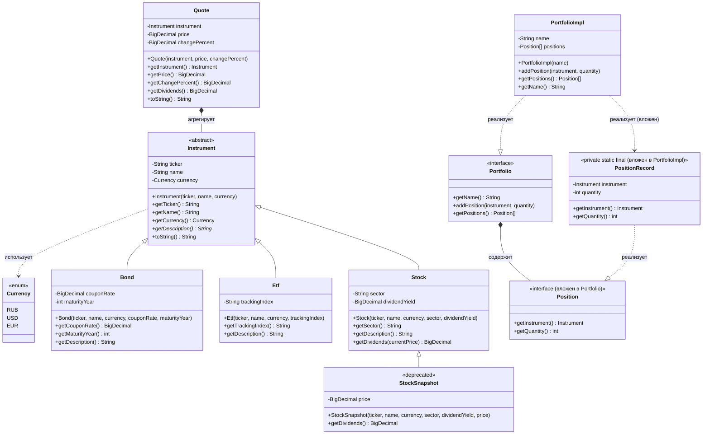

# Диаграмма классов `academy.backend.market_pulse.model`

Визуализация иерархии классов и описание атрибутов.

## Иерархия классов

## Описание атрибутов

### Instrument (абстрактный класс) — базовая абстракция финансового инструмента

| Атрибут | Тип | Описание |
|---------|-----|----------|
| `ticker` | `String` | Уникальный биржевой тикер инструмента. **Инвариант:** не может быть `null` или пустой строкой — проверяется в конструкторе, при нарушении бросается `IllegalArgumentException`. |
| `name` | `String` | Человекочитаемое название инструмента. |
| `currency` | `Currency` | Валюта, в которой номинирован инструмент (RUB/USD/EUR). |

Абстрактный метод: `getDescription()` — возвращает строковое описание типа инструмента, реализуется в наследниках.

### Currency (enum)

| Константа | Описание |
|-----------|----------|
| `RUB` | Российский рубль |
| `USD` | Доллар США |
| `EUR` | Евро |

### Bond extends Instrument — облигация

| Атрибут | Тип | Описание |
|---------|-----|----------|
| `couponRate` | `BigDecimal` | Купонная доходность облигации, в процентах. |
| `maturityYear` | `int` | Год погашения облигации. |

`getDescription()`: «Облигация, купон: X%, погашение: Y».

### Etf extends Instrument — биржевой инвестиционный фонд

| Атрибут | Тип | Описание |
|---------|-----|----------|
| `trackingIndex` | `String` | Биржевой индекс, который отслеживает фонд. |

`getDescription()`: «ETF, отслеживает индекс: X».

### Stock extends Instrument — акция

| Атрибут | Тип | Описание |
|---------|-----|----------|
| `sector` | `String` | Отрасль/сектор, к которому относится акция. |
| `dividendYield` | `BigDecimal` | Дивидендная доходность, в процентах. **NOTICE:** хранится в `BigDecimal`, а не `double`, так как это денежная величина. |

Метод `getDividends(BigDecimal currentPrice)`: рассчитывает размер дивидендов как `currentPrice * dividendYield / 100` (округление `HALF_UP`, 2 знака).

### StockSnapshot extends Stock (deprecated) — акция с зафиксированной ценой

| Атрибут | Тип | Описание |
|---------|-----|----------|
| `price` | `BigDecimal` | Цена акции на конкретный момент времени. |

**Проблема дизайна:** пытался решить задачу «акция + цена» через наследование от `Stock`, но `getDividends(BigDecimal)` из родителя не исчезает, а `getDividends()` без аргумента — это перегрузка, а не переопределение. Непонятно, какой метод вызовет клиентский код. Помечен `@Deprecated`, **заменяется агрегацией** `Quote` и подлежит удалению после рефакторинга.

### Quote — рыночная котировка (агрегация, не наследование)

| Атрибут | Тип | Описание |
|---------|-----|----------|
| `instrument` | `Instrument` | Инструмент, к которому относится котировка (агрегация). |
| `price` | `BigDecimal` | Текущая цена инструмента. |
| `changePercent` | `BigDecimal` | Изменение цены за период, в процентах. |

Метод `getDividends()`: делегирует расчёт в `Stock.getDividends(price)`, если инструмент — акция; иначе возвращает `BigDecimal.ZERO`. `toString()` показывает тренд стрелками (▲/▼/▬).

### Portfolio (interface) — портфель пользователя

| Метод | Описание |
|-------|----------|
| `getName()` | Название портфеля. |
| `addPosition(Instrument, int)` | Добавляет позицию — инструмент и его количество. |
| `getPositions()` | Возвращает все позиции массива (коллекции ещё не пройдены, поэтому `Position[]`). |

Вложенный интерфейс `Position`:

| Метод | Описание |
|-------|----------|
| `getInstrument()` | Инструмент позиции. |
| `getQuantity()` | Количество инструмента в позиции. |

### PortfolioImpl implements Portfolio — эталонная реализация

| Атрибут | Тип | Описание |
|---------|-----|----------|
| `name` | `String` | Название портфеля. |
| `positions` | `Position[]` | Массив позиций; динамически расширяется при добавлении (`Arrays.copyOf`). |

Вложенный класс `PositionRecord` (private static final) — неизменяемая реализация `Position`:

| Атрибут | Тип | Описание |
|---------|-----|----------|
| `instrument` | `Instrument` | Инструмент позиции. |
| `quantity` | `int` | Количество инструмента в позиции. |

## Сводка связей

- **Наследование:** `Instrument` (abstract) → `Bond`, `Etf`, `Stock`; `Stock` → `StockSnapshot` (deprecated).
- **Реализация:** `PortfolioImpl implements Portfolio`; `PositionRecord implements Portfolio.Position`.
- **Агрегация:** `Quote` содержит ссылку на `Instrument` (заменяет наследование `StockSnapshot`).
- **Использование:** `Instrument` использует enum `Currency`.